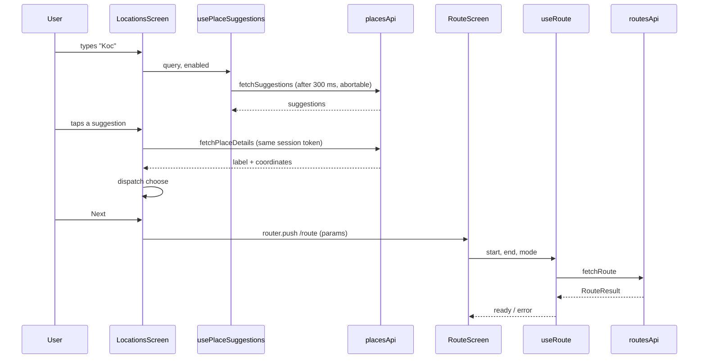

# TripPath — Architecture

> Describes the code as implemented. Related: [Coding standards](07-CODING-STANDARDS.md) · [Data models](06-DATA-MODELS.md) · [Testing](10-TESTING-AND-QA.md).

## 1. Folder structure

```text
src/
├── app/                     Expo Router routes (thin: re-export the screens)
│   ├── _layout.tsx          fonts, SafeAreaProvider, status bar, Stack navigator
│   ├── index.tsx            redirects to /login
│   ├── login.tsx            → features/auth/LoginScreen
│   ├── locations.tsx        → features/locations/LocationsScreen
│   └── route.tsx            → features/route/RouteScreen
├── features/
│   ├── auth/                LoginScreen, AuthModals (demo forgot-password / sign-up)
│   ├── locations/           LocationsScreen, TripFields, SuggestionList,
│   │                        tripForm (reducer + validation), locationRows (row building)
│   └── route/               RouteScreen (param parsing), RouteDetails, RouteSummary,
│                            ModeSelector, StepList, InvalidRouteState,
│                            maneuverIcon, startNavigation, travelModes
├── hooks/                   useRoute, usePlaceSuggestions, useCurrentLocation
├── services/                placesApi, routesApi, geocoding
├── components/              shared UI: AppModal, BrandMark, FloatingIconButton, NoticeBanner,
│   │                        PrimaryButton, RouteRail, SectionLabel, TextField, TripPlaces
│   └── map/                 MapPicker(.web), RouteMap(.web), RoutePins, routeMapHtml,
│                            mapConfig, routeMapTypes, mapPickerTypes
├── constants/               config, strings, theme, mapStyle, savedPlaces
├── types/                   geo, places, route
└── utils/                   auth, coordinates, format, inlineScriptJson, mapRegion,
                             polyline, sessionToken
tests/                       mirrors src/ (plus mocks/ and helpers.ts)
```

## 2. Layers and dependency direction

```
app  →  features  →  hooks  →  services  →  (Google APIs, expo-location)
              ↘          ↘           ↘
               components     utils / constants / types   (leaf modules)
```

| Layer        | Responsibility                                                                                                       | May import                                |
| ------------ | -------------------------------------------------------------------------------------------------------------------- | ----------------------------------------- |
| `app`        | Route files only. No logic.                                                                                          | `features`                                |
| `features`   | Screens and the pieces only that screen uses. Compose hooks and components.                                          | everything below                          |
| `hooks`      | Async state: loading / ready / error, aborting, stale-response protection.                                           | `services`, `utils`, `constants`, `types` |
| `services`   | The only code that calls `fetch` or `expo-location`. Build requests, validate and map responses, throw typed errors. | `utils`, `constants`, `types`             |
| `components` | Presentational and reusable. Props in, callbacks out.                                                                | `constants`, `utils`, `types`             |
| `utils`      | Pure functions. No React, no I/O.                                                                                    | `constants`, `types`                      |
| `constants`  | Config, copy and design tokens. No logic.                                                                            | `types`                                   |

## 3. State management

There is no global store; the flow does not need one.

- **Screen state** is local (`useState` / `useReducer`). The location form is a pure reducer (`tripForm.ts`) with actions `focus`, `type`, `clear`, `choose`, `swap` and a `validateTrip` selector.
- **Cross-screen data** travels as route params (`pickup`, `dropoff`, `pickupLat`, `pickupLng`, `dropoffLat`, `dropoffLng`). The route screen re-parses them with `parseCoordinate`; malformed params show an explicit invalid state instead of a guessed route.
- **Server state** lives in hooks. `useRoute` and `usePlaceSuggestions` key their result by the inputs that produced it, so an answer for old inputs is never shown for new ones, and they abort the in-flight request when inputs change or the component unmounts.

## 4. Data flow: choosing places and showing a route



## 5. Error handling

| Source                       | Handling                                                                                        |
| ---------------------------- | ----------------------------------------------------------------------------------------------- |
| Missing API key              | Places: notice on the locations screen, search disabled. Routes: "Configuration required" state |
| Routes API disabled          | `RoutesApiError('api-disabled')` with an enablement hint                                        |
| HTTP / malformed Routes body | `RoutesApiError('request-failed' \| 'invalid-response')`, shown as "Route unavailable"          |
| Places HTTP / malformed body | `PlacesError`; autocomplete shows a retry notice, place details show an alert                   |
| Aborted request              | Ignored silently (superseded or unmounted)                                                      |
| Geocoding failure            | Falls back to rounded coordinates as the label                                                  |
| Permission denied / GPS off  | Inline notice; the field is left unchanged                                                      |

## 6. Platform-specific code

`react-native-maps` has no web support, so map components are split by file extension: `RouteMap.tsx` / `RouteMap.web.tsx` and `MapPicker.tsx` / `MapPicker.web.tsx`. Metro picks the `.web` variant for web builds. `mapConfig.ts` imports the native module and must only be imported from native files. The web route map is a Leaflet page built by `routeMapHtml.ts` and rendered in an iframe; every dynamic value is escaped with `serializeForInlineScript`.

## 7. Configuration

Keys and endpoints live in `src/constants/config.ts`. `EXPO_PUBLIC_*` variables must be read as literal `process.env.EXPO_PUBLIC_X` expressions so Metro can inline them. Native Maps SDK keys are injected at build time by `app.config.ts` (`GOOGLE_MAPS_ANDROID_API_KEY`, `GOOGLE_MAPS_IOS_API_KEY`). Hooks and services take the key as a parameter defaulting to the configured value, which keeps them testable.
