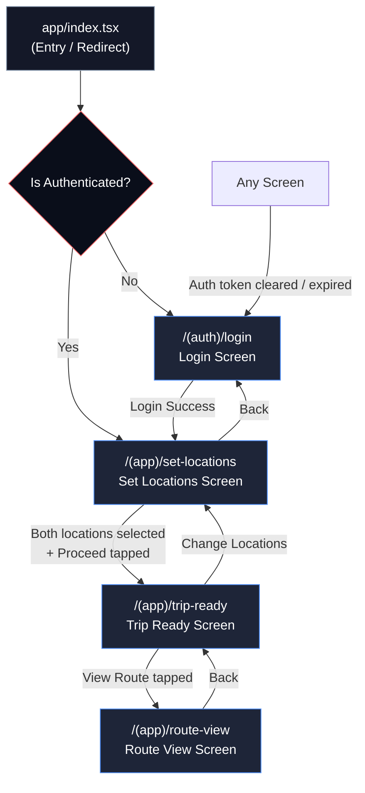
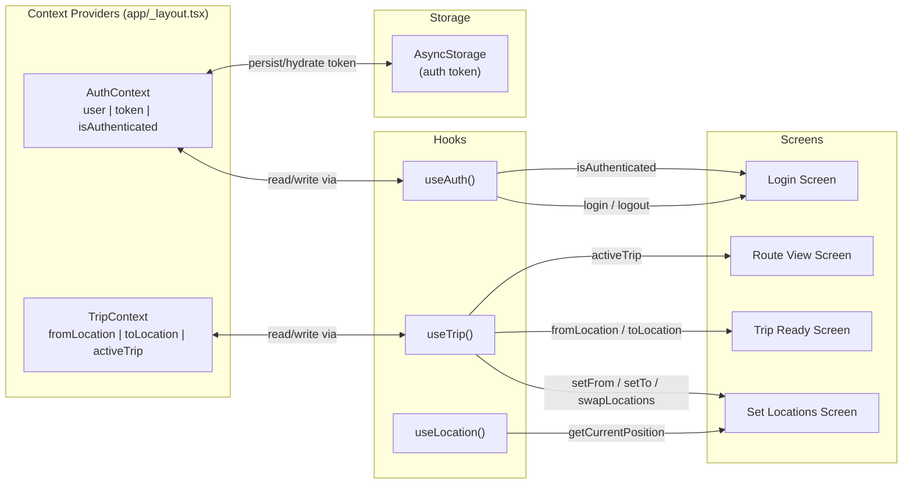

# TripPath — Architecture

> **Document:** 02 — System Architecture  
> **Status:** Finalized (Pre-development)

---

## 1. Project Folder Structure

```
codenzic-trip-planner/
│
├── app/                                    # Expo Router file-based routes
│   ├── _layout.tsx                         # Root layout — font loading, auth guard, NavigationContainer
│   ├── index.tsx                           # Entry point — splash redirect logic
│   │
│   ├── (auth)/                             # Auth route group (no tab bar)
│   │   ├── _layout.tsx                     # Auth stack layout (slide transitions)
│   │   └── login.tsx                       # Login screen
│   │
│   └── (app)/                              # Authenticated route group
│       ├── _layout.tsx                     # App stack layout (slide + modal transitions)
│       ├── set-locations.tsx               # Set Locations screen
│       ├── trip-ready.tsx                  # Trip Ready screen
│       └── route-view.tsx                  # Route View screen (full-screen map)
│
├── components/                             # Shared UI components
│   ├── ui/                                 # Primitive design system components
│   │   ├── Button.tsx                      # Multi-variant button (primary, secondary, ghost, danger)
│   │   ├── Input.tsx                       # Form input with label, error, icon support
│   │   ├── Card.tsx                        # Surface container with optional elevation/press
│   │   └── Badge.tsx                       # Small label chip (distance, type tags)
│   │
│   ├── map/                                # Map-specific components
│   │   ├── MapView.tsx                     # Wrapper around react-native-maps MapView
│   │   └── RoutePolyline.tsx               # Animated polyline between two coordinates
│   │
│   ├── location/                           # Location selection components
│   │   ├── LocationItem.tsx                # Single location row (icon, name, address, badge)
│   │   └── LocationSearchBar.tsx           # Search input with clear button + focus state
│   │
│   └── trip/                               # Trip summary components
│       ├── TripSummaryCard.tsx             # From → To card with connector line
│       └── RouteInfoPanel.tsx              # Distance, ETA, mode row
│
├── constants/                              # App-wide constants (no logic)
│   ├── colors.ts                           # Full color palette tokens
│   ├── typography.ts                       # Font sizes, weights, line heights
│   ├── spacing.ts                          # Spacing scale (4px base grid)
│   └── mockData.ts                         # Static mock locations and trips
│
├── context/                                # React Context providers
│   ├── AuthContext.tsx                     # Auth state, login/logout actions, token persistence
│   └── TripContext.tsx                     # Active trip state (from, to, tripData)
│
├── hooks/                                  # Custom React hooks
│   ├── useAuth.ts                          # Consume AuthContext (convenience wrapper)
│   ├── useLocation.ts                      # expo-location permission + current coords
│   └── useTrip.ts                          # Consume TripContext + trip derivation helpers
│
├── types/                                  # TypeScript type definitions
│   └── index.ts                            # All interfaces/types exported from one file
│
├── utils/                                  # Pure utility functions
│   ├── validation.ts                       # Zod schemas + validation helpers
│   └── helpers.ts                          # Formatters, distance calc, coordinate utils
│
├── assets/
│   ├── fonts/
│   │   └── Inter-*.ttf                     # Inter font family files
│   └── images/
│       ├── logo.png                        # TripPath logo
│       ├── trip-illustration.png           # Trip Ready screen illustration
│       └── adaptive-icon.png               # Android adaptive icon
│
├── app.json                                # Expo configuration
├── eas.json                                # EAS Build profiles
├── package.json                            # Dependencies and scripts
├── tsconfig.json                           # TypeScript configuration (strict mode)
├── .eslintrc.js                            # ESLint configuration
├── .prettierrc                             # Prettier configuration
├── babel.config.js                         # Babel config (reanimated plugin last)
└── README.md                               # Public-facing documentation
```

---

## 2. Navigation Architecture

### Route Groups

Expo Router uses **route groups** (parenthesized folder names) that do not contribute to the URL path but allow separate layout wrappers.

| Group    | Path Prefix | Layout            | Purpose                 |
| -------- | ----------- | ----------------- | ----------------------- |
| `(auth)` | `/(auth)/`  | Stack (no header) | Unauthenticated screens |
| `(app)`  | `/(app)/`   | Stack             | Authenticated screens   |

### Navigation Flowchart



### Screen Transition Map

| Transition                      | Animation                       | Platform Notes                       |
| ------------------------------- | ------------------------------- | ------------------------------------ |
| Login → Set Locations           | Fade                            | Feels like session start, not a push |
| Set Locations → Trip Ready      | Slide from right                | Standard forward navigation          |
| Trip Ready → Route View         | Slide from bottom (modal-style) | Map feels like it's coming up        |
| Route View → Trip Ready (back)  | Slide down                      | Reverses modal entry                 |
| Any screen → Login (auth guard) | Fade                            | Avoids jarring redirect              |

---

## 3. State Management Strategy

### Philosophy

> **Use the right tool for the job.** This app has two distinct slices of shared state: authentication session and the active trip. Both are excellent candidates for React Context — they are read by many components but written by few. Introducing Redux, Zustand, or Jotai would add complexity without benefit at this scale.

### Context Slices

#### `AuthContext`

```
Responsibility: User session lifecycle
State: user, token, isAuthenticated, isLoading
Actions: login(email, password), logout()
Persistence: AsyncStorage for token (re-hydrated on app boot)
Consumers: _layout.tsx (auth guard), useAuth hook, Login screen
```

#### `TripContext`

```
Responsibility: Active trip planning session
State: fromLocation, toLocation, activeTrip
Actions: setFrom(location), setTo(location), swapLocations(), clearTrip(), setTrip(trip)
Persistence: None (session-only — cleared when user logs out or starts new trip)
Consumers: Set Locations screen, Trip Ready screen, Route View screen
```

### Data Flow Diagram



---

## 4. File Naming Conventions

| Entity Type                | Convention                          | Example             |
| -------------------------- | ----------------------------------- | ------------------- |
| Screen files (Expo Router) | `kebab-case.tsx`                    | `set-locations.tsx` |
| Layout files               | `_layout.tsx`                       | `_layout.tsx`       |
| Components (PascalCase)    | `PascalCase.tsx`                    | `LocationItem.tsx`  |
| Hooks                      | `camelCase.ts` (prefix `use`)       | `useLocation.ts`    |
| Utilities                  | `camelCase.ts`                      | `helpers.ts`        |
| Context                    | `PascalCase.tsx` (suffix `Context`) | `AuthContext.tsx`   |
| Types                      | `index.ts`                          | `types/index.ts`    |
| Constants                  | `camelCase.ts`                      | `colors.ts`         |

---

## 5. Auth Guard Pattern

The auth guard lives in `app/_layout.tsx` — the root layout that wraps every route in the application.

### Implementation Pattern

```
On mount:
  1. Read token from AsyncStorage
  2. If token exists → set isAuthenticated = true in AuthContext
  3. If no token → set isAuthenticated = false

On every render of _layout.tsx:
  - Watch isAuthenticated from AuthContext
  - If false → redirect to /(auth)/login (replace, not push — no back button to login)
  - If true → render Slot (child routes)

On login success:
  - Store token in AsyncStorage
  - Update AuthContext.isAuthenticated = true
  - Navigation automatically re-renders to /(app)/set-locations

On logout:
  - Clear AsyncStorage
  - Update AuthContext.isAuthenticated = false
  - Navigation automatically re-renders to /(auth)/login
```

### Why `Slot` + Redirect (Not Conditional Render)?

Using `router.replace()` inside a `useEffect` that watches `isAuthenticated` is the Expo Router idiomatic pattern. It keeps the navigation stack clean — users cannot press "back" from an authenticated screen into login after logging in, or vice versa.

```
app/_layout.tsx pseudo-logic:

  const { isAuthenticated, isLoading } = useAuth();
  const segments = useSegments();

  useEffect(() => {
    if (isLoading) return; // Wait for AsyncStorage hydration

    const inAuthGroup = segments[0] === '(auth)';

    if (!isAuthenticated && !inAuthGroup) {
      router.replace('/(auth)/login');
    } else if (isAuthenticated && inAuthGroup) {
      router.replace('/(app)/set-locations');
    }
  }, [isAuthenticated, isLoading, segments]);
```

---

## 6. Module Boundaries

The following rules enforce clear module separation and prevent circular dependencies:

| Rule                      | Details                                                         |
| ------------------------- | --------------------------------------------------------------- |
| Screens → Components      | ✅ Screens import from `components/`                            |
| Screens → Hooks           | ✅ Screens import from `hooks/`                                 |
| Components → Constants    | ✅ Components import from `constants/`                          |
| Components → Types        | ✅ Components import from `types/`                              |
| Hooks → Context           | ✅ Hooks consume `context/`                                     |
| Hooks → Utils             | ✅ Hooks call `utils/` functions                                |
| Context → Utils           | ✅ Context may call `utils/`                                    |
| Context → Screens         | ❌ FORBIDDEN — context never imports screens                    |
| Components → Hooks        | ⚠️ Allowed only for `useAuth` and `useTrip` in smart components |
| Components → Context      | ❌ FORBIDDEN — always go through hooks                          |
| Utils → anything internal | ❌ FORBIDDEN — utils are pure, import only from `types/`        |

---

## 7. TypeScript Configuration

`tsconfig.json` key settings:

```json
{
  "compilerOptions": {
    "strict": true,
    "noImplicitAny": true,
    "strictNullChecks": true,
    "noUnusedLocals": true,
    "noUnusedParameters": true,
    "exactOptionalPropertyTypes": false,
    "baseUrl": ".",
    "paths": {
      "@components/*": ["components/*"],
      "@constants/*": ["constants/*"],
      "@hooks/*": ["hooks/*"],
      "@context/*": ["context/*"],
      "@types/*": ["types/*"],
      "@utils/*": ["utils/*"]
    }
  }
}
```

Path aliases (`@components/`, `@hooks/`, etc.) are used throughout the codebase to prevent deeply nested relative import chains.

---

_See `03-DESIGN-SYSTEM.md` for visual design tokens, `04-SCREEN-SPECS.md` for screen-level detail._
