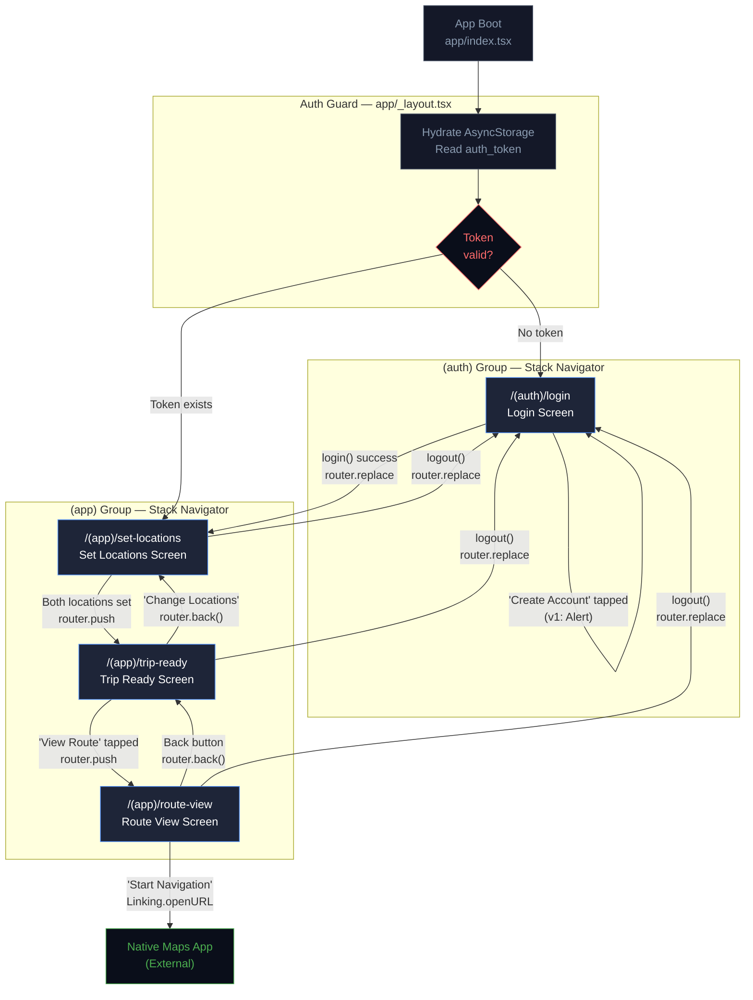
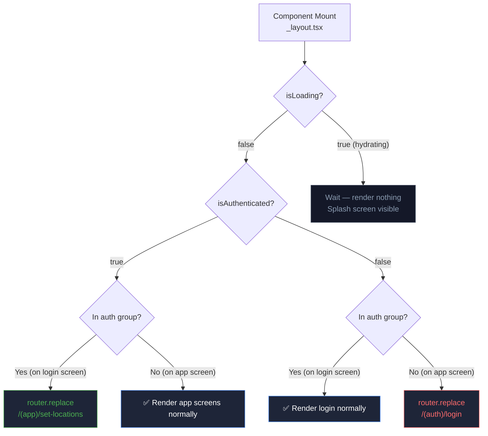

# TripPath — Navigation Flow

> **Status note:** this document is the original pre-development plan. The shipped app differs (light theme with orange accent, flat Expo Router files in `app/`, local component state, no auth context, Google Places/Routes instead of mock data). The current state is in [README.md](../README.md) (`./README.md` for this file if at repo root) and [PROJECT-SETUP.md](PROJECT-SETUP.md).

> **Document:** 09 — Navigation Architecture & Screen Transitions  
> **Status:** Finalized (Pre-development)

---

## 1. Complete Navigation Map



---

## 2. Navigation Stack Structure

### Root Layout (`app/_layout.tsx`)

The root layout is the outermost shell. It:

1. Loads fonts (`useFonts` from `expo-font`)
2. Manages `SplashScreen` visibility
3. Provides `AuthContext` and `TripContext`
4. Implements the auth guard (watches `isAuthenticated`)
5. Renders `<Slot />` (child routes)

```
Root Layout (AuthContext, TripContext)
└── Slot
    ├── (auth)/_layout.tsx  → Stack
    │   └── login.tsx
    └── (app)/_layout.tsx   → Stack
        ├── set-locations.tsx
        ├── trip-ready.tsx
        └── route-view.tsx
```

### Auth Group Layout (`app/(auth)/_layout.tsx`)

```typescript
// Simple Stack with no header
<Stack screenOptions={{ headerShown: false }}>
  <Stack.Screen name="login" />
</Stack>
```

### App Group Layout (`app/(app)/_layout.tsx`)

```typescript
// Stack with custom header for app screens
<Stack
  screenOptions={{
    headerShown: false,        // Custom headers per screen
    contentStyle: { backgroundColor: Colors.Background },
    animation: 'slide_from_right',  // Default forward animation
  }}
>
  <Stack.Screen name="set-locations" />
  <Stack.Screen name="trip-ready" />
  <Stack.Screen
    name="route-view"
    options={{ animation: 'slide_from_bottom' }}  // Modal-style
  />
</Stack>
```

---

## 3. Screen Transition Specifications

| Transition          | From → To                  | Animation                | Duration | Notes                                                                                    |
| ------------------- | -------------------------- | ------------------------ | -------- | ---------------------------------------------------------------------------------------- |
| **Auth to App**     | Login → Set Locations      | `fade`                   | 300ms    | Feels like a session start, not a stack push. Implemented via `router.replace` (no back) |
| **Forward (App)**   | Set Locations → Trip Ready | `slide_from_right`       | 350ms    | Standard iOS/Android forward navigation                                                  |
| **Modal**           | Trip Ready → Route View    | `slide_from_bottom`      | 400ms    | Map "comes up" from below — modal presentation                                           |
| **Back (Modal)**    | Route View → Trip Ready    | `slide_from_top` (auto)  | 400ms    | Auto-reverse of modal entry                                                              |
| **Back (Standard)** | Trip Ready → Set Locations | `slide_from_left` (auto) | 350ms    | Auto-reverse of forward push                                                             |
| **Auth Redirect**   | Any → Login                | `fade`                   | 250ms    | Fast, non-jarring redirect when token cleared                                            |

### Platform Differences

| Platform | Native Stack Behavior                                                      | Gesture                         |
| -------- | -------------------------------------------------------------------------- | ------------------------------- |
| iOS      | Slide from right with native parallax                                      | Swipe right to go back          |
| Android  | Slide from right, no parallax                                              | System back button, or swipe    |
| Both     | `gesture-direction: horizontal` for standard forward, `vertical` for modal | Configurable per `Stack.Screen` |

---

## 4. Navigation API Usage

### Expo Router Navigation Methods

| Method                  | Usage                                           | Adds to Stack    |
| ----------------------- | ----------------------------------------------- | ---------------- |
| `router.push(href)`     | Navigate forward to a new screen                | ✅ Yes           |
| `router.replace(href)`  | Navigate, replacing current entry (no back)     | ❌ No            |
| `router.back()`         | Go back to previous screen                      | N/A (pops stack) |
| `router.navigate(href)` | Push if different, pop if already in stack      | Depends          |
| `<Link href={...}>`     | Declarative navigation (avoid in complex flows) | ✅ Yes           |

### Passing Data Between Screens

**Strategy:** For complex objects (like `Trip`), store in `TripContext`. Use route params only for lightweight identifiers.

```typescript
// ✅ CORRECT: Store trip in context, navigate without params
const handleProceed = () => {
  setTrip(buildTrip(fromLocation, toLocation, tripMeta));
  router.push('/(app)/route-view');
};

// ✅ ALSO VALID: Pass a simple ID as param
router.push({
  pathname: '/(app)/trip-ready',
  params: { tripId: 'trip_001' },
});
// Then in the screen: const { tripId } = useLocalSearchParams<{ tripId: string }>();

// ❌ AVOID: Serializing large objects as params (URL length limits, encoding issues)
router.push({
  pathname: '/(app)/route-view',
  params: { trip: JSON.stringify(largeObject) }, // Bad practice
});
```

---

## 5. Deep Link Structure

Expo Router automatically generates deep links from the file structure. The `scheme` in `app.json` is `trippath`.

| Screen        | Deep Link URL                   | Notes                                            |
| ------------- | ------------------------------- | ------------------------------------------------ |
| Login         | `trippath:///auth/login`        | Rarely deep-linked to                            |
| Set Locations | `trippath:///app/set-locations` | Entry point for authenticated users              |
| Trip Ready    | `trippath:///app/trip-ready`    | Requires context — not practically deep-linkable |
| Route View    | `trippath:///app/route-view`    | Requires context — not practically deep-linkable |

> **v1 Note:** Deep linking is not a feature requirement for this assignment. The scheme is configured for future extensibility.

### Universal Links / App Links

Not configured for v1. Production implementation would require:

- **iOS:** `apple-app-site-association` file on the domain
- **Android:** `assetlinks.json` file on the domain
- Configuration in `app.json` under `ios.associatedDomains` and `android.intentFilters`

---

## 6. Back Navigation Behavior

| Screen            | Android Back                     | iOS Swipe Back                  | Back Button in UI          |
| ----------------- | -------------------------------- | ------------------------------- | -------------------------- |
| **Login**         | Exits app (root screen)          | N/A (no back gesture on root)   | None                       |
| **Set Locations** | Cannot go back (auth group root) | N/A                             | None                       |
| **Trip Ready**    | Goes to Set Locations            | Swipe right → Set Locations     | `←` icon button (top-left) |
| **Route View**    | Goes to Trip Ready               | Swipe down (modal) → Trip Ready | `←` icon button (top-left) |

### Preventing Back Navigation

On Set Locations screen (to prevent going back to login after successful auth):

```typescript
// app/(app)/_layout.tsx
<Stack.Screen
  name="set-locations"
  options={{
    gestureEnabled: false,    // Disable swipe-back gesture
    headerLeft: () => null,   // No back button in header
  }}
/>
```

---

## 7. Auth Guard Implementation

### Location: `app/_layout.tsx`

```typescript
import { useEffect } from 'react';
import { useSegments, useRouter, Slot } from 'expo-router';
import { useAuth } from '@hooks/useAuth';

export default function RootLayout() {
  const { isAuthenticated, isLoading } = useAuth();
  const segments = useSegments();
  const router = useRouter();

  useEffect(() => {
    if (isLoading) {
      // Still hydrating AsyncStorage — don't redirect yet
      return;
    }

    const inAuthGroup = segments[0] === '(auth)';

    if (!isAuthenticated && !inAuthGroup) {
      // Unauthenticated user trying to access app screens → redirect to login
      router.replace('/(auth)/login');
    } else if (isAuthenticated && inAuthGroup) {
      // Authenticated user on login screen → redirect to app
      router.replace('/(app)/set-locations');
    }
    // Otherwise, user is in the correct group — do nothing
  }, [isAuthenticated, isLoading, segments]);

  if (isLoading) {
    // Keep splash screen visible while loading
    return null;
  }

  return <Slot />;
}
```

### Auth Guard Flow Diagram



---

## 8. Navigation State Reset

When a user logs out, the navigation state must be fully reset to prevent the user from pressing the Android back button to return to authenticated screens.

```typescript
// hooks/useAuth.ts — logout handler
const logout = useCallback(async () => {
  await AsyncStorage.multiRemove([STORAGE_KEYS.AUTH_TOKEN, STORAGE_KEYS.AUTH_USER]);
  clearTrip(); // Clear TripContext
  setAuthState({ user: null, token: null, isAuthenticated: false, isLoading: false });
  // Auth guard useEffect in _layout.tsx will automatically redirect to login
  // Using router.replace ensures the auth stack is cleared
}, [clearTrip]);
```

The auth guard's `useEffect` re-fires whenever `isAuthenticated` changes, so calling `setAuthState` is sufficient — no manual `router.replace` call needed inside the hook.

---

_See `04-SCREEN-SPECS.md` for per-screen interaction details. See `02-ARCHITECTURE.md` for the overall system architecture._
