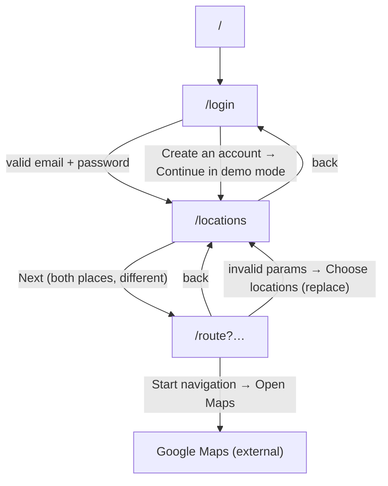

# TripPath — Navigation Flow

> Expo Router, file-based. Routes are defined by the files in `src/app`. Related: [Screen specs](04-SCREEN-SPECS.md).

## 1. Route map

| URL          | File                    | Screen               | Params                                                                    |
| ------------ | ----------------------- | -------------------- | ------------------------------------------------------------------------- |
| `/`          | `src/app/index.tsx`     | Redirect to `/login` | none                                                                      |
| `/login`     | `src/app/login.tsx`     | Login                | none                                                                      |
| `/locations` | `src/app/locations.tsx` | Set locations        | none                                                                      |
| `/route`     | `src/app/route.tsx`     | Route view           | `pickup`, `dropoff`, `pickupLat`, `pickupLng`, `dropoffLat`, `dropoffLng` |

`src/app/_layout.tsx` renders a single `Stack` with `headerShown: false` and a `fade` animation, inside `SafeAreaProvider`. It waits for the fonts to load (or fail) before rendering, so no screen flashes in the wrong font. Typed routes are enabled (`experiments.typedRoutes`), so `router.push('/route')` is checked by TypeScript once Expo has generated its route types.

## 2. Flow

## 3. Transitions

| From         | Action                                  | Call                                          |
| ------------ | --------------------------------------- | --------------------------------------------- |
| `/`          | mount                                   | `<Redirect href="/login" />`                  |
| `/login`     | successful login / demo sign-up         | `router.push('/locations')`                   |
| `/locations` | Next with two distinct places           | `router.push({ pathname: '/route', params })` |
| `/locations` | back button                             | `router.back()`                               |
| `/route`     | floating back button                    | `router.back()`                               |
| `/route`     | "Choose locations" on the invalid state | `router.replace('/locations')`                |
| `/route`     | "Open Maps" in the confirmation dialog  | `Linking.openURL(buildNavigationUrl(…))`      |

## 4. Guards and validation

- There is **no auth guard**: login is a demo and nothing persists. Any route can be opened directly.
- `/route` never trusts its params. `parseCoordinate` must succeed for both endpoints, otherwise `InvalidRouteState` is shown and no request is made. `0,0` is a valid coordinate.
- `/locations` validates before navigating (`validateTrip`): incomplete → alert, identical coordinates → alert.

## 5. Back stack notes

- Login → locations uses `push`, so back from locations returns to login.
- The invalid route state uses `replace`, so the broken route is not left on the stack.
- Both modals on the login screen are local state (not routes); the Android hardware back button closes them via `onRequestClose`.
